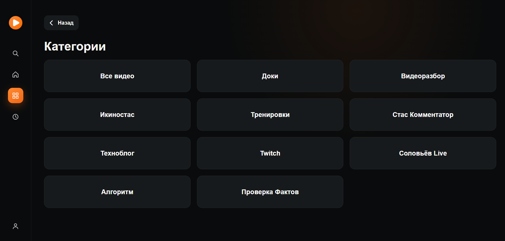
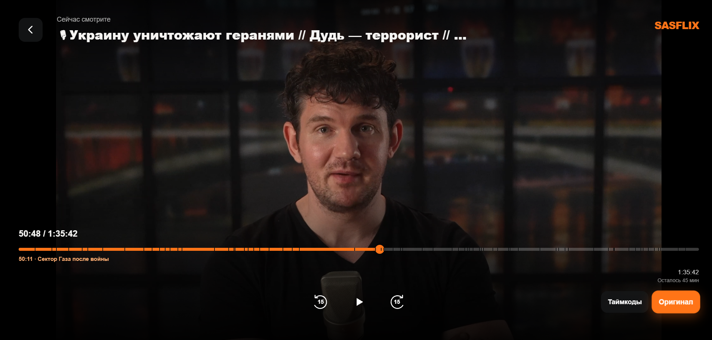
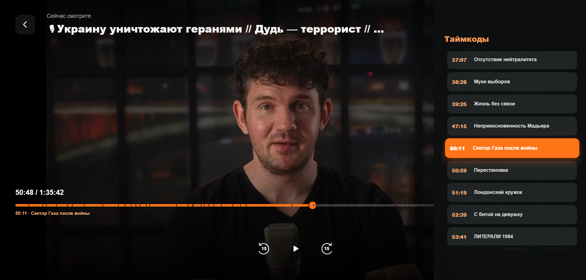

# Сасфликс для LG webOS TV

Версия приложения: **1.0** (`1.0.0` в манифесте webOS).

Самостоятельное телевизионное приложение для просмотра контента [Сасфликса](https://sasflix.ru/) на LG webOS. Приложение имеет собственный интерфейс, навигацию для пульта и полноэкранный плеер. Страницы сайта, iframe и Media Station X не используются.

## Скриншоты

<p align="center">
  
  
</p>
<p align="center">
  
  
</p>
<p align="center">
  
</p>

## Совместимость

- Целевая платформа: **LG webOS TV 4.0 и новее**.
- Основное целевое устройство разработки: **LG 49UK6390PLG**, firmware **05.50.70**.
- Интерфейс рассчитан на разрешение **1920 × 1080** и масштабируется движком телевизора.
- Код написан с учётом Chromium 53, используемого в webOS 4: ES5-синтаксис, CSS-fallback для Flexbox и отсутствие обязательных современных UI-фреймворков.
- Для воспроизведения необходим доступ телевизора к `sasflix.ru`, `media.sasflix.ru` или `mirror.sasflix.ru`; HLS также использует `reflector.sasflix.ru`.

На более новых версиях webOS приложение использует тот же Web Runtime и системный медиадекодер. Реальная поддержка конкретного видео зависит от кодека, контейнера и возможностей телевизора.

## Возможности

- Главная страница с каруселью пяти последних выпусков и автоматическим переключением.
- Каталог в три колонки по 12 видео на страницу, названия и обложки целиком без обрезки.
- Раздел «Продолжить просмотр» с локальной позицией и позицией из аккаунта.
- Раздел «История просмотра» объединяет серверные отметки аккаунта и локальный журнал запусков.
- Категории Сасфликса, включая «Стас Комментатор».
- Поиск через API Сасфликса с серверной сортировкой по релевантности: название, описание, теги и расшифровка.
- Авторизация аккаунтом Сасфликса и доступ к видео по активной подписке.
- Синхронизация позиции просмотра с аккаунтом и локальная резервная копия на телевизоре.
- Немедленный запуск видео по OK без промежуточной карточки или всплывающего окна.
- Оригинальный MP4 до 4K через системный плеер телевизора.
- HLS с ручным выбором качества до 1080p и автоматическим восстановлением после сетевых или декодерных ошибок.
- Перемотка на 15 секунд, ускоренная перемотка при повторных нажатиях и превью кадра.
- Светлая полоса загруженной части видео на шкале времени.
- Главы и таймкоды: отметки на шкале и отдельный список справа.
- Автоматический переход к следующему видео с обратным отсчётом и отменой.
- Скрытая диагностика плеера по кнопке Info или синей кнопке пульта.
- Заставка и логотип Сасфликса при запуске.

## Управление пультом

- **Стрелки** перемещают фокус между элементами.
- **OK** открывает раздел, запускает видео или активирует выбранную кнопку.
- **Влево** из содержимого переводит фокус в боковое меню. **Вправо** возвращает на первый элемент страницы или на последний выбранный элемент содержимого.
- На экране категорий первым выбирается пункт «Все видео», а не кнопка «Назад».
- **Колесо Magic Remote** прокручивает каталог. Поддерживаются события `wheel` и `mousewheel` старых прошивок.
- **Назад** в плеере сразу возвращает на страницу, с которой было открыто видео. Если открыты качество, таймкоды, диагностика или окно следующего видео, первое нажатие закрывает этот слой.
- **Влево/вправо на шкале** перематывают видео. Повторные быстрые нажатия увеличивают шаг.
- **Info или синяя кнопка** показывают движок, фактическое качество, буфер, состояние декодера и версию hls.js.

Анимация карточек занимает 45 мс. Плавная прокрутка страницы отключена, яркость через CSS-фильтр при фокусе не пересчитывается. Все обложки текущей страницы начинают загружаться сразу, чтобы старый Web Runtime не задерживал их до получения фокуса. Каталог и категории кешируются на 10 минут, при этом серверные данные обновляются в фоне.

## Как устроено приложение

Приложение упаковано как стандартное webOS Web App. Это основной формат приложений webOS с интерфейсом на HTML, CSS и JavaScript, который выполняется локально в Web Runtime телевизора.

```text
app/
├── appinfo.json       манифест webOS, версия, иконки и точка запуска
├── index.html         экраны каталога, категорий, форм и плеера
├── styles.css         телевизионная раскладка, фокус и оформление
├── app.js             API, навигация пульта, состояние и воспроизведение
├── vendor/hls.min.js  локальная сборка hls.js 1.7.3
└── *.png              иконки и заставка
```

### Данные и аккаунт

Каталог, категории, поиск, профиль, главы и ссылки на видео загружаются непосредственно с `https://sasflix.ru/api/`. Вход выполняется сервером Сасфликса. Приложение хранит в `localStorage` только выданный токен, выбранное качество и резервную позицию просмотра. Пароль не сохраняется; при выходе токен удаляется.

### Воспроизведение

В режиме «Оригинал» приложение передаёт MP4 системному декодеру webOS. Это снижает расход памяти и позволяет телевизору использовать аппаратное декодирование, включая 4K при наличии совместимого файла. Если прямой файл не воспроизводится, приложение переключается на HLS.

Для HLS используется локальная облегчённая UMD-сборка [hls.js 1.7.3](https://github.com/video-dev/hls.js/releases/tag/v1.7.3). Буфер ограничен для телевизоров с небольшим объёмом памяти, worker отключён, старые сегменты освобождаются. При остановке времени воспроизведения watchdog пытается восстановить поток. Лицензия библиотеки находится в `app/vendor/HLS-LICENSE.txt`.

### Память

Перед запуском видео приложение удаляет изображения каталога из DOM. При выходе уничтожается экземпляр hls.js, очищается источник `<video>` и освобождается декодер. Перед следующим видео выдерживается короткая пауза, чтобы webOS успела вернуть память медиаподсистемы.

## Готовый пакет

[Скачать Sasflix webOS 1.0.0](https://github.com/Mrboob58/Sasflix-webOS/releases/download/v1.0.0/ru.sasflix.webosclient_1.0.0_all.ipk)

SHA-256: `0E90EEEE3757907E5274A13440AE704DD981EFA1E6ACD8AA19888CD7F91596F0`

## Сборка

На Windows установите Node.js и [webOS CLI](https://webostv.developer.lge.com/develop/tools/cli-installation), затем выполните:

```powershell
npm install -g @webos-tools/cli
.\build.ps1
```

Скрипт также умеет использовать локальные Node.js и webOS CLI из каталога `.tools`. Готовый IPK создаётся в `dist`.

## Установка на телевизор

Включите Developer Mode на LG TV, добавьте телевизор в webOS CLI и выполните:

```powershell
ares-install --device myTV .\dist\ru.sasflix.webosclient_1.0.0_all.ipk
ares-launch --device myTV ru.sasflix.webosclient
```

`myTV` замените именем своего устройства. Если на телевизоре установлена тестовая сборка с номером выше `1.0.0`, удалите её перед установкой финальной версии 1.0: webOS может отклонить пакет как понижение версии.

### Через Dangbro и Homebrew Channel

[Dangbro](https://github.com/azoffshowy/dangbro) устанавливает root-доступ и Homebrew Channel на совместимые телевизоры. По официальной таблице поддерживаются webOS 7.x–25 и телевизоры с DVB-тюнером в перечисленных авторами регионах. Для LG 49UK6390PLG с webOS 4 используйте Developer Mode или подберите совместимый способ через [CanI.RootMy.TV](https://cani.rootmy.tv/).

На поддерживаемом телевизоре:

1. Откройте [Dangbro](https://azoffshowy.github.io/dangbro/) в Chrome на компьютере в одной локальной сети с телевизором.
2. Введите IP телевизора, подключитесь и подтвердите запрос сопряжения на телевизоре.
3. Дождитесь установки Homebrew Channel, перезагрузите телевизор и убедитесь, что в настройках Homebrew Channel указано `Root OK`.
4. Включите SSH в Homebrew Channel, подключитесь к телевизору и выполните:

```sh
luna-send-pub -i 'luna://org.webosbrew.hbchannel.service/install' '{"ipkUrl":"https://github.com/Mrboob58/Sasflix-webOS/releases/download/v1.0.0/ru.sasflix.webosclient_1.0.0_all.ipk","ipkHash":"0E90EEEE3757907E5274A13440AE704DD981EFA1E6ACD8AA19888CD7F91596F0","subscribe":true}'
```

Homebrew Channel скачает пакет из GitHub Release, проверит SHA-256 и установит приложение. Если Dangbro сообщает об ошибке сертификата, следуйте разделу Troubleshooting в его официальном README.

Доступ к платным видео определяется подпиской пользователя на Сасфликсе.
